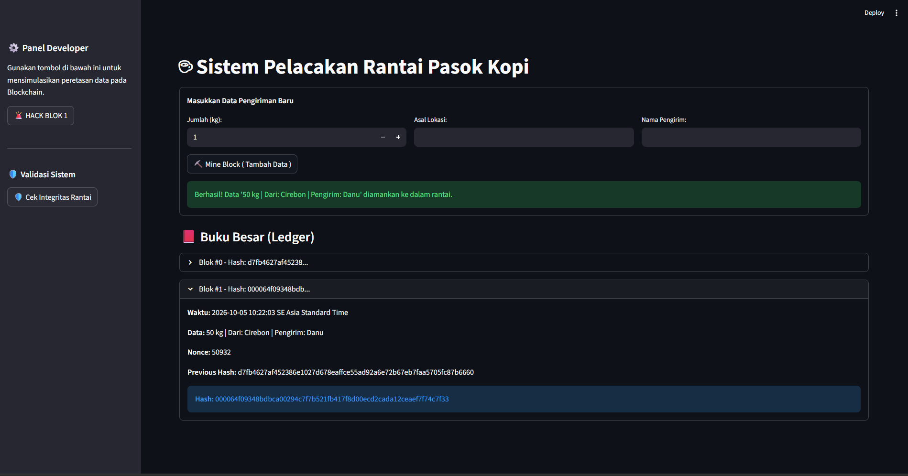
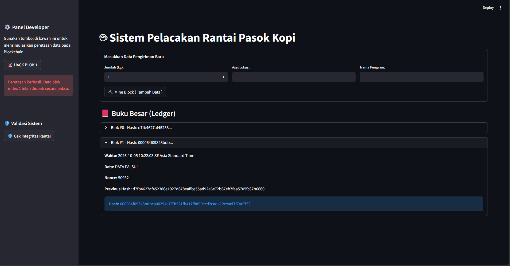
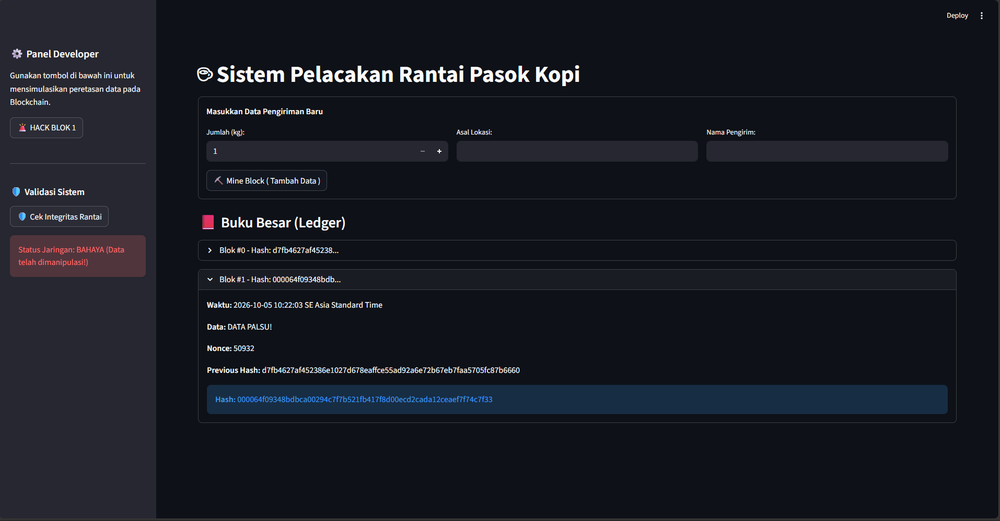

# Laporan Praktikum: Sistem Pelacakan Rantai Pasok Kopi Berbasis Blockchain

## 1. Pendahuluan
Praktikum ini bertujuan untuk memahami dan mengimplementasikan konsep dasar teknologi Blockchain menggunakan bahasa pemrograman Python. Sistem yang dibangun adalah prototipe **Sistem Pelacakan Rantai Pasok Kopi** (*Coffee Supply Chain*), di mana setiap data pengiriman kopi akan dicatat sebagai blok di dalam rantai (blockchain) yang saling terhubung melalui kriptografi (SHA-256).

## 2. Struktur Proyek
Sistem ini dibangun menggunakan dua file utama:
*   `core.py`: Berisi logika inti (Back-end) dari Blockchain. Di sini terdapat definisi *Class* `Block` (untuk struktur data setiap blok) dan `Blockchain` (untuk mengelola rantai, konsensus, dan validasi).
*   `app.py`: Berisi antarmuka pengguna (Front-end) berbasis web yang dibangun menggunakan pustaka **Streamlit**. File ini memungkinkan interaksi pengguna untuk menambah data, melihat buku besar, dan mensimulasikan peretasan.

## 3. Penjelasan Logika Inti (`core.py`)
### A. Class `Block`
Setiap blok memiliki atribut:
*   `index`: Posisi blok dalam rantai.
*   `timestamp`: Waktu saat blok dibuat (dilengkapi dengan properti `timestamp_readable` untuk zona waktu lokal).
*   `data`: Informasi transaksi (Jumlah kg, Lokasi, Nama Pengirim).
*   `previous_hash`: Jejak kriptografi dari blok sebelumnya untuk menjaga keterikatan.
*   `nonce`: Angka acak yang digunakan saat *mining* (Proof of Work).
*   `hash`: Nilai unik (sidik jari) dari blok yang dihasilkan oleh fungsi `calculate_hash()`.

Fungsi `mine_block(difficulty)` menerapkan mekanisme **Proof of Work**. Sistem akan terus melakukan iterasi dengan menambah nilai `nonce` hingga ditemukan hash yang diawali dengan angka "0" sebanyak nilai `difficulty` (dalam hal ini diset 4).

### B. Class `Blockchain`
*   `create_genesis_block()`: Membuat blok pertama (Genesis Block) secara otomatis saat sistem dijalankan.
*   `add_block()`: Menambahkan blok baru, menghubungkannya dengan *previous_hash* dari blok terakhir, dan menambangnya (*mining*).
*   `is_chain_valid()`: Fungsi krusial untuk memeriksa integritas. Sistem akan mengecek dua hal:
    1. Apakah `hash` saat ini cocok dengan perhitungan ulang data di dalam blok?
    2. Apakah `previous_hash` di blok saat ini benar-benar sama dengan `hash` di blok sebelumnya?

## 4. Antarmuka dan Fitur Pengguna (`app.py`)
Antarmuka dibagi menjadi tiga bagian utama:
1.  **Form Tambah Data**: Menggunakan `st.form` untuk menginput Jumlah Kopi (kg), Asal Lokasi, dan Nama Pengirim. Ketika tombol "Mine Block" ditekan, data disatukan menjadi string dan dimasukkan ke dalam blok baru.
2.  **Buku Besar (Ledger)**: Menampilkan seluruh riwayat blok dari Genesis Block hingga yang terbaru menggunakan `st.expander`.
3.  **Panel Developer (Sidebar)**: 
    *   **HACK BLOK 1**: Tombol untuk memanipulasi data di memori secara paksa (`st.session_state.kopi_chain.chain[1].data = "DATA PALSU!"`).
    *   **Cek Integritas Rantai**: Mengevaluasi fungsi `is_chain_valid()` dan menampilkan status jaringan (Aman atau Bahaya).

## 5. Hasil Pengujian (Skenario Praktikum)

### Pengujian 1: Menambah Data Normal
*   **Aksi**: Memasukkan data (misal: 50 kg, Cirebon, Danu) dan menekan "Mine Block".
*   **Hasil**: Sistem berhasil melakukan *mining*. Buku besar menampilkan blok baru dengan *Previous Hash* yang sama dengan *Hash* Genesis Block. Status jaringan divalidasi "AMAN".
*   **Foto Program**: 

### Pengujian 2: Simulasi Serangan (Hacking)
*   **Aksi**: Menekan tombol 🚨 **HACK BLOK 1** pada Panel Developer.
*   **Hasil**: Sistem memberikan notifikasi bahwa data di index 1 telah diubah secara paksa menjadi "DATA PALSU!". Jika kita melihat Ledger, data pada blok ke-1 telah berubah.
*   **Foto Program**: 

### Pengujian 3: Deteksi Integritas
*   **Aksi**: Menekan tombol 🛡️ **Cek Integritas Rantai** setelah peretasan dilakukan.
*   **Hasil**: Sistem mengeluarkan peringatan "Status Jaringan: BAHAYA". Mengapa? Karena isi data di blok 1 berubah, sehingga jika di-hash ulang, nilainya tidak akan sama dengan `hash` asli yang tersimpan di blok tersebut. Keterikatan rantai menjadi rusak.
*   **Foto Program**: 

## 6. Kesimpulan
Melalui praktikum ini, terbukti bagaimana karakteristik **Immutability (Kekekalan)** dalam Blockchain bekerja. 
Sistem Hash kriptografi memastikan bahwa setiap perubahan kecil pada data di masa lalu (seperti yang dilakukan pada fungsi Hack) akan merusak validitas hash tersebut. Karena setiap blok menyimpan hash dari blok sebelumnya, perubahan pada satu blok akan membuat seluruh rantai di depannya menjadi tidak valid atau terdeteksi telah dimanipulasi. 
