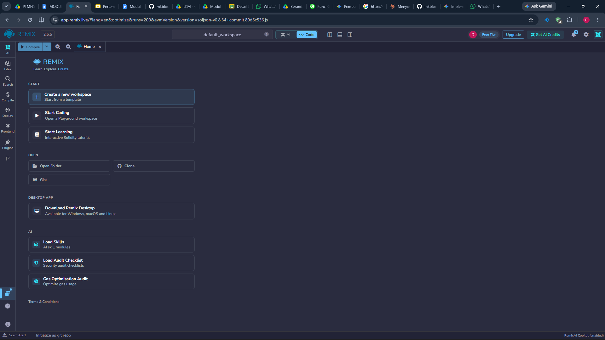
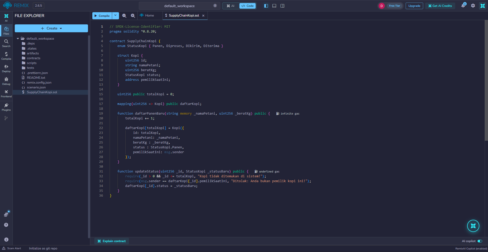
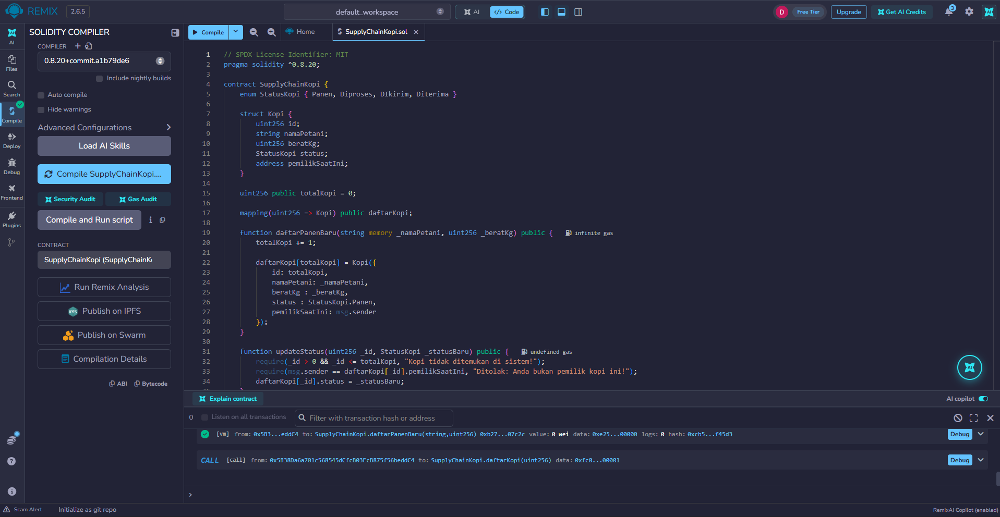
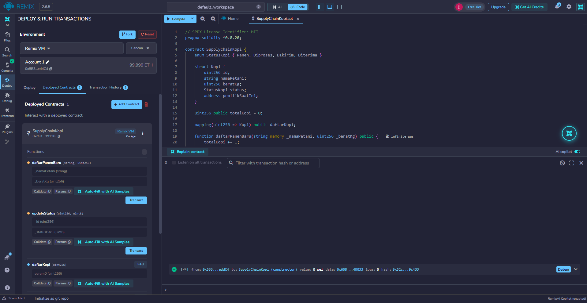
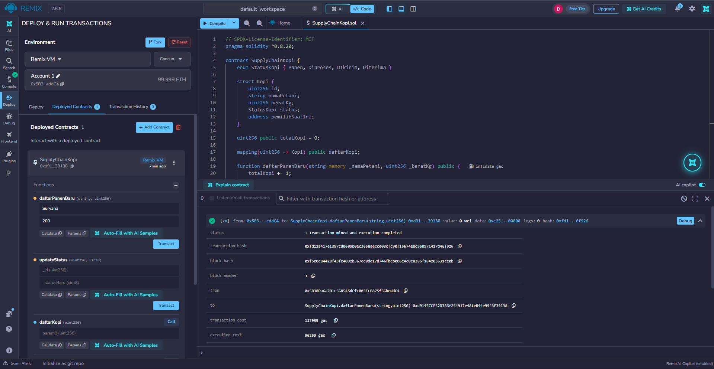
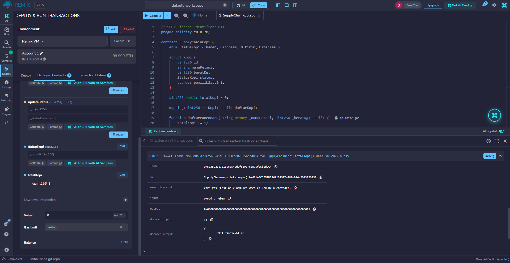
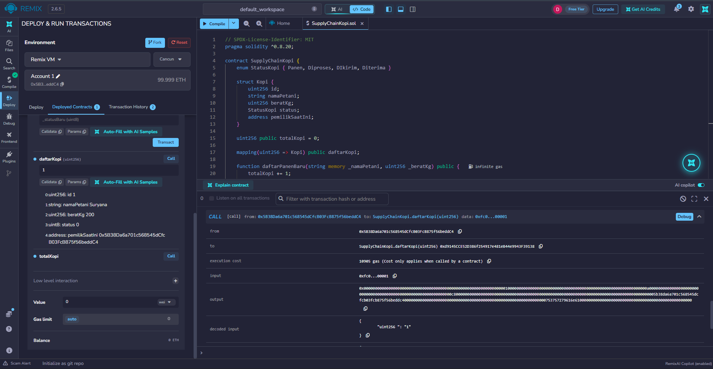
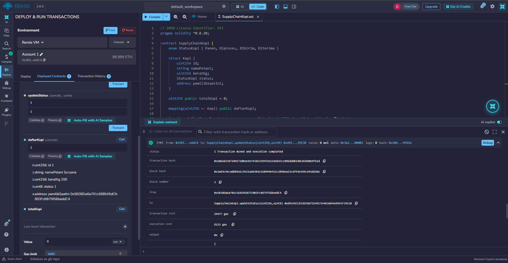
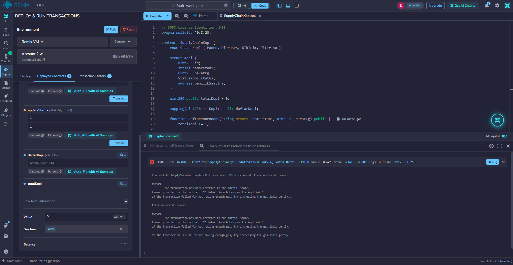

# Praktikum 6: Membuat Smart Contract dengan Solidity di Remix #

## Tujuan Pembelajaran 
Setelah menyelesaikan praktikum ini, mahasiswa di harapkan mampu:
1. Memahami konsep dasar dari smart contract pada Blockchain.
2. Menggunakan platform Remix untuk menulis, mengompilasi, dan men-deploy smart contract berbasis Solidity.
3. Mengimplementasikan fungsionalitas dasar smart contract yang melibatkan state variable dan fungsi.
4. Melakukan interaksi dengan smart contract yang sudah ter-deploy melalui Remix.

## Proses Praktikum 

1. Buka [Remix IDE](https://remix.ethereum.org/) login via Gmail, bukti:

2. Selanjutnya membuat file Smart Contract baru.
    - Pada panel File Explorer disebelah kiri Remix IDE, buatlah sebuah file baru didalam default_workspace.
    - Beri nama file tersebut dengan (SupplyChainKopi.sol).
    - Tuliskan kode smart contract mengenai rantai pasok kopi menggunakan bahasa Solidity seperti dibawah ini:
     

3. Berikut adalah Komponen dan Fungsi didalam Smart Contact tersebut:
    1. enum StatusKopi
        - Ini adalah tipe data bentukan yang mendefinisikan tahapan atau status kopi dalam rantai pasok.
        - Status yang tersedia adalah: Panen (saat baru dipanen), Diproses (sedang diolah), DIkirim (sedang dalam perjalanan), dan Diterima (sudah sampai di tujuan).
    2. struct Kopi
        - Ini adalah struktur data yang menyimpan informasi detail dari setiap batch atau pengiriman kopi.
        - Di dalamnya menyimpan data: id (nomor identitas unik), namaPetani (nama petani kopi), beratKg (berat kopi dalam kilogram), status (status kopi saat ini, diambil dari enum), dan pemilikSaatIni (alamat wallet di blockchain yang saat ini memegang atau bertanggung jawab atas kopi tersebut).
    3. State Variables (totalKopi dan daftarKopi)
        - uint256 public totalKopi = 0;: Variabel untuk melacak jumlah total data kopi yang sudah terdaftar di dalam sistem. Nilai awalnya adalah 0.
        - mapping(uint256 => Kopi) public daftarKopi;: Berfungsi seperti sebuah database. Mapping ini menghubungkan ID (berupa angka/uint256) ke detail kopi (berupa tipe data Kopi).
    4. Fungsi daftarPanenBaru
        - Tujuan: Fungsi ini digunakan oleh petani untuk mendaftarkan hasil panen kopi baru ke dalam sistem blockchain.
        - Cara Kerja:
            - Fungsi menerima input _namaPetani dan _beratKg.
            - Pertama, fungsi akan menambahkan nilai totalKopi sebanyak 1 (sebagai ID baru).
            - Kemudian, fungsi membuat data kopi baru di dalam memori daftarKopi dengan memberikan nilai status awal yaitu StatusKopi.Panen.
            - Fungsi ini juga secara otomatis menetapkan msg.sender (alamat dompet/akun MetaMask yang mengeksekusi fungsi ini) sebagai pemilikSaatIni.
    5. Fungsi updateStatus
        - Tujuan: Fungsi ini digunakan untuk memperbarui atau mengubah status kopi seiring dengan perjalanannya di rantai pasok (misalnya dari 'Panen' menjadi 'Dikirim').
        - Cara Kerja:
            - Fungsi menerima input _id (ID kopi yang ingin diubah) dan _statusBaru (status yang baru).
            - Validasi 1 (require pertama): Mengecek apakah ID yang dimasukkan itu valid (ID harus lebih besar dari 0 dan tidak boleh melebihi totalKopi yang ada). Jika salah, akan muncul pesan error: "Kopi tidak ditemukan di sistem!".
            - Validasi 2 (require kedua): Mengecek apakah akun yang mencoba mengubah status adalah pemilik sah kopi tersebut saat ini. Hanya msg.sender yang cocok dengan data pemilikSaatIni yang diizinkan untuk mengubah status. Jika tidak cocok, muncul pesan: "Ditolak: Anda bukan pemilik kopi ini!".
            - Jika kedua syarat di atas terpenuhi, barulah sistem akan memperbarui nilai status dari kopi tersebut menjadi _statusBaru.

4. Hasil Kompilasi, Deployment, dan Pengujian (Output)
    - Setelah kode smart contract selesai ditulis, langkah selanjutnya adalah melakukan kompilasi dan deploy ke jaringan simulasi (Remix VM) untuk menguji fungsinya.
    1. Kompilasi Smart Contract
        - Buka menu Solidity Compiler di panel sebelah kiri.
        - Pastikan Compiler yang dipilih sesuai dengan pragma di kode (misalnya versi 0.8.20 atau yang lebih baru).
        - Klik tombol Compile SupplyChainKopi.sol.
        - Hasil: Kompilasi berhasil ditandai dengan munculnya ikon centang hijau pada logo Solidity Compiler.
        
    2. Deploy Smart Contract
        - Pindah ke menu Deploy & run transactions di panel sebelah kiri.
        - Pada bagian Environment, pilih Remix VM (Cancun) atau jaringan lokal bawaan Remix lainnya.
        - Pastikan Contract yang terpilih adalah SupplyChainKopi - default_workspace/SupplyChainKopi.sol.
        - Klik tombol Deploy.
        - Hasil: Di bagian bawah panel, pada menu Deployed Contracts, akan muncul smart contract Anda yang sudah aktif beserta daftar fungsi yang bisa dijalankan. Di terminal bawah juga akan muncul log transaksi berwarna hijau.
        
    3. Pengujian Fungsi (Interaksi Smart Contract)
        - Pada tahap ini setiap fungsi yang di buat akan di uji untuk mensimulasikan rantai pasok kopi.
            1. Mendaftarkan Panen Baru (daftarPanenBaru)
                - Buka dropdown pada contract yang sudah di-deploy.
                - Pada fungsi daftarPanenBaru, masukkan parameter berikut:
                    - _namaPetani: "Suryana"
                    - _beratKg: 200
                - Klik tombol transact.
                - Hasil: Transaksi berhasil (centang hijau di terminal). Data panen baru telah tersimpan di blockchain.
                
            2. Mengecek Data Kopi yang Tersimpan.
                - Klik tombol fungsi totalKopi.
                    - Hasil: Nilainya harus 1 (karena baru 1 data yang dimasukkan).
                    
                - Pada fungsi daftarKopi, masukkan angka 1 (sebagai ID kopi pertama), lalu klik panggil/tampil.
                    - Hasil: Akan mengembalikan detail array data: id: 1, namaPetani: "Suryana", beratKg: 200, status: 0 (0 mewakili status 'Panen' pada enum), dan alamat wallet pemilik.
                    
            3. Memperbarui Status Kopi (updateStatus)
                - Pada fungsi updateStatus, masukkan parameter:
                    - _id: 1 (ID kopi Budi)
                    - _statusBaru: 1 (Angka 1 mewakili status 'Diproses' pada enum)
                - Klik tombol transact.
                - Hasil: Transaksi berhasil. Jika Anda memanggil kembali fungsi daftarKopi dengan ID 1, nilai statusnya akan berubah menjadi 1.
                
            4. Pengujian Validasi Keamanan (Error Handling)
                - Pada bagian atas menu Deploy & run transactions, ubah Account (wallet address) ke akun/alamat yang berbeda dari akun yang digunakan saat deploy.
                - Cobalah jalankan kembali fungsi updateStatus untuk ID 1.
                - Hasil: Transaksi akan digagalkan (revert) oleh sistem dengan pesan error: "Ditolak: Anda bukan pemilik kopi ini!". Hal ini membuktikan bahwa validasi keamanan require pada smart contract berjalan dengan baik.
                

## Kesimpulan 

Berdasarkan praktikum yang telah dilakukan, dapat ditarik beberapa kesimpulan sebagai berikut:
1. Pemahaman Konsep & Implementasi: Praktikum ini berhasil mengimplementasikan konsep dasar smart contract menggunakan bahasa pemrograman Solidity. Penggunaan struktur data khusus seperti struct (untuk mendefinisikan detail entitas Kopi), enum (untuk melacak tahapan/status), dan mapping (sebagai basis data penyimpanan) sangat efektif untuk mensimulasikan pencatatan sistem rantai pasok (Supply Chain) kopi secara terstruktur.
2. Validasi dan Akses Kontrol: Penerapan error handling menggunakan fungsi require terbukti berfungsi dengan baik dalam memberikan lapisan keamanan dasar. Sistem berhasil menolak upaya pembaruan status kopi jika dilakukan oleh pihak yang bukan merupakan pemilikSaatIni dari entitas kopi tersebut.
3. Pemanfaatan Remix IDE: Platform Remix IDE terbukti sangat memudahkan dalam siklus pengembangan smart contract. Seluruh tahapan mulai dari penulisan kode, kompilasi (Solidity Compiler), deployment pada lingkungan simulasi (Remix VM), hingga pengujian dan interaksi fungsi-fungsi contract dapat dilakukan dalam satu interface berbasis web tanpa memerlukan konfigurasi jaringan (RPC) yang rumit.
4. Potensi Teknologi: Smart contract SupplyChainKopi ini menjadi gambaran awal bagaimana teknologi blockchain dapat dimanfaatkan untuk menciptakan sistem pelacakan rantai pasok logistik yang transparan, aman, dan meminimalkan manipulasi data oleh pihak yang tidak bertanggung jawab.