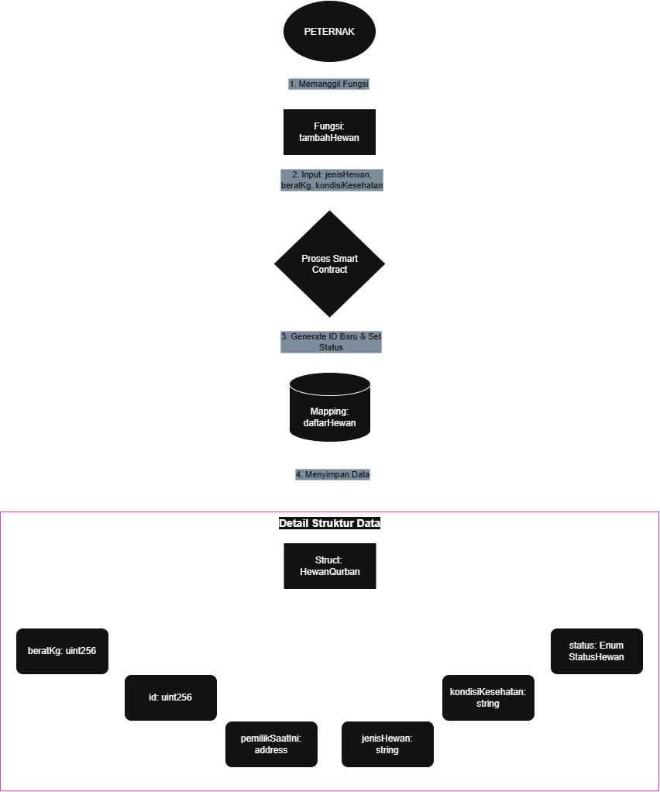
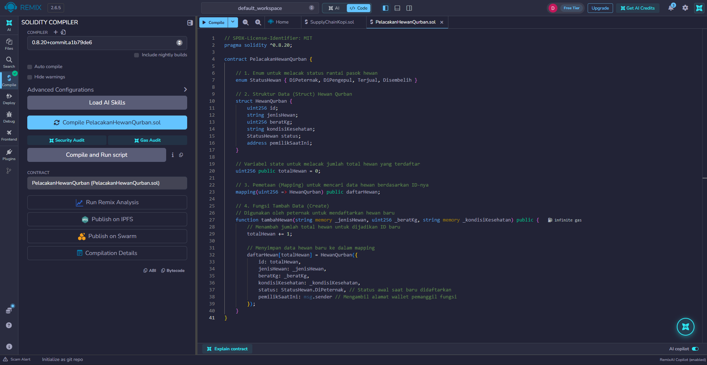
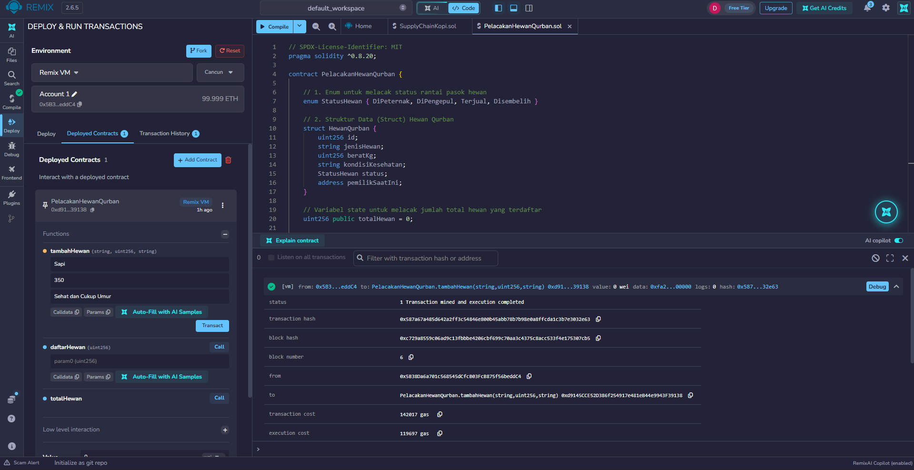
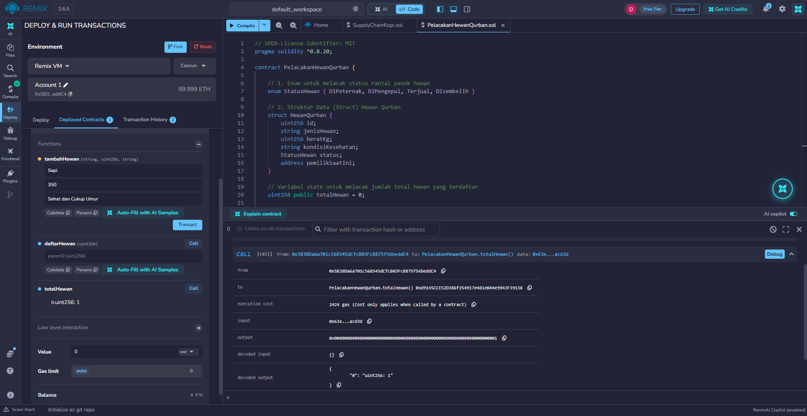
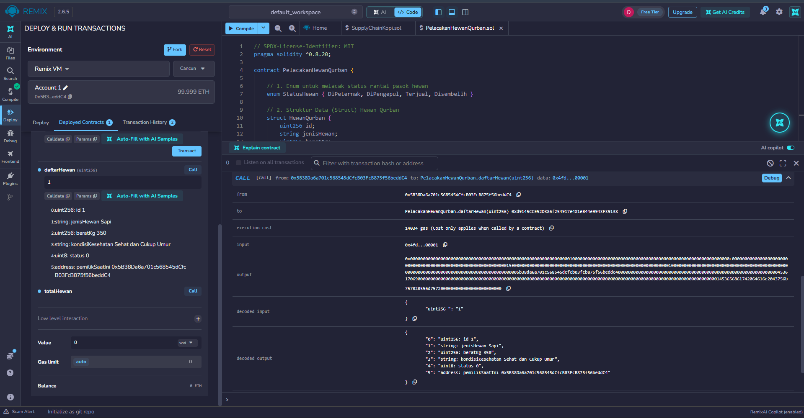

# LAPORAN EVALUASI & TUGAS KELOMPOK PERTEMUAN 6
**Mata Kuliah:** Blockchain
**Topik Proyek:** Sistem Pelacakan Rantai Pasok Hewan Qurban

**Anggota Kelompok:**
1. [Danu Suryana]
2. [Moh. Nukhas Herdiansyah]
3. [Mohammad Farizul Haq]

---

## 1. Desain Arsitektur (Konsep & Flowchart)

Berdasarkan domain proyek **Sistem Pelacakan Rantai Pasok Hewan Qurban**, berikut adalah rancangan arsitektur *smart contract* yang kami buat:

### A. Struktur Data (`Struct`)
Informasi yang wajib direkam untuk setiap hewan qurban di dalam *blockchain* meliputi:
*   `id` (`uint256`): Nomor identitas unik hewan.
*   `jenisHewan` (`string`): Jenis hewan (contoh: Sapi, Kambing, Domba).
*   `beratKg` (`uint256`): Berat hewan dalam kilogram.
*   `kondisiKesehatan` (`string`): Keterangan kondisi fisik/kesehatan hewan.
*   `status` (`Enum StatusHewan`): Status hewan dalam rantai pasok (DiPeternak, DiPengepul, Terjual, Disembelih).
*   `pemilikSaatIni` (`address`): Alamat *wallet* pemilik hewan saat ini.

### B. Pemetaan (`Mapping`)
Pencarian data dilakukan berdasarkan ID unik hewan. Kami menggunakan pemetaan berikut:
`mapping(uint256 => HewanQurban) public daftarHewan;`

### C. Alur Fungsi dan Bagan (Flowchart)
Fungsi utama pada versi pertama ini adalah `tambahHewan()` yang digunakan untuk mendaftarkan (*Create*) data hewan qurban baru ke dalam sistem.

Berikut adalah desain *flowchart* alur kerjanya:


---

## 2. Drafting Smart Contract (Versi 1)

Berikut adalah implementasi dari desain di atas ke dalam bahasa Solidity (`PelacakanHewanQurban.sol`). Kode ini telah berhasil di-*compile* tanpa *error* di platform Remix IDE.

```solidity
// SPDX-License-Identifier: MIT
pragma solidity ^0.8.20;

contract PelacakanHewanQurban {
    
    // 1. Enum untuk melacak status rantai pasok hewan
    enum StatusHewan { DiPeternak, DiPengepul, Terjual, Disembelih }

    // 2. Struktur Data (Struct) Hewan Qurban
    struct HewanQurban {
        uint256 id;
        string jenisHewan;
        uint256 beratKg;
        string kondisiKesehatan;
        StatusHewan status;
        address pemilikSaatIni;
    }

    // Variabel state untuk melacak jumlah total hewan yang terdaftar
    uint256 public totalHewan = 0;

    // 3. Pemetaan (Mapping) untuk mencari data hewan berdasarkan ID-nya
    mapping(uint256 => HewanQurban) public daftarHewan;

    // 4. Fungsi Tambah Data (Create)
    function tambahHewan(string memory _jenisHewan, uint256 _beratKg, string memory _kondisiKesehatan) public {
        totalHewan += 1;

        daftarHewan[totalHewan] = HewanQurban({
            id: totalHewan,
            jenisHewan: _jenisHewan,
            beratKg: _beratKg,
            kondisiKesehatan: _kondisiKesehatan,
            status: StatusHewan.DiPeternak,
            pemilikSaatIni: msg.sender 
        });
    }
}
```

---

## 3. Simulasi dan Pengujian (Remix IDE)

Pengujian dilakukan menggunakan jaringan lokal bawaan Remix VM. Berikut adalah dokumentasi hasilnya:

### A. Proses Kompilasi dan Deployment
Smart contract berhasil di-*compile* (centang hijau pada *Solidity Compiler*) dan di-*deploy* ke dalam Remix VM tanpa kendala.


### B. Pengujian Fungsi `tambahHewan`
Kami melakukan simulasi pendaftaran hewan baru dengan menginputkan data:
*   `_jenisHewan`: "Sapi"
*   `_beratKg`: 350
*   `_kondisiKesehatan`: "Sehat dan Cukup Umur"

Transaksi berhasil dieksekusi dengan status sukses (log hijau di terminal Remix).


### C. Verifikasi Data Tersimpan
Setelah data ditambahkan, kami melakukan pemanggilan variabel dan pemetaan untuk memverifikasi data:
1.  **Pemanggilan `totalHewan`:** Mengembalikan nilai `1`.

2.  **Pemanggilan `daftarHewan` (dengan ID `1`):** Mengembalikan detail lengkap struktur data hewan qurban, status bernilai `0` (DiPeternak), dan mencatat alamat *wallet deployer* sebagai pemilik saat ini.


---

## 4. Penutup / Kesimpulan

Pada tahap evaluasi minggu ini, kelompok kami telah berhasil merancang arsitektur awal (bagan alir dan struktur data) untuk proyek pelacakan rantai pasok hewan qurban berbasis *blockchain*. Implementasi tahap 1 ke dalam *smart contract* menggunakan *struct*, *mapping*, dan fungsi penciptaan data (Create) telah diuji coba di Remix IDE dan berjalan sesuai dengan logika yang direncanakan.